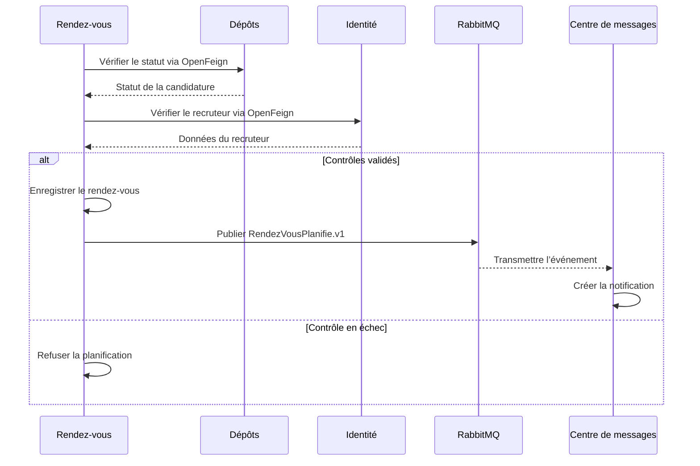

# Documentation technique de JobBoard 


## 1. Objectif du projet

JobBoard AWD est une plateforme de recrutement qui centralise les offres d’emploi, les candidatures et les entretiens. Elle permet au candidat de suivre l’avancement de son dossier et au recruteur de gérer les candidatures reçues pour ses annonces.

| Acteur | Actions principales |
|---|---|
| Candidat | Créer un compte, compléter son dossier, ajouter son CV, consulter les offres, postuler, suivre ses candidatures et consulter ses rendez-vous. |
| Recruteur | Publier des annonces, examiner les candidatures reçues, présélectionner des candidats, planifier ou annuler des entretiens. |

Le parcours principal commence par la publication d’une annonce. Le candidat dépose sa candidature, le recruteur l’examine et peut la présélectionner. La présélection permet ensuite de planifier un entretien. Le candidat est informé de la planification ou de l’annulation du rendez-vous.

## 2. Architecture générale

Le frontend **Angular** envoie les requêtes à l’**API Gateway**, qui les transmet au microservice **Spring Boot** concerné. **Eureka** tient le registre des services. Les services utilisent **OpenFeign** pour les appels REST qui nécessitent une réponse immédiate et **RabbitMQ** pour diffuser les événements traités en arrière-plan.

| Composant | Rôle dans JobBoard AWD |
|---|---|
| Angular | Afficher les écrans de connexion, d’annonces, de candidatures et de rendez-vous. |
| API Gateway | Fournir un point d’entrée commun et acheminer les requêtes vers les services. |
| Eureka | Enregistrer les services et permettre leur découverte par nom. |
| Spring Boot | Exécuter les règles métier et exposer les API REST. |
| JWT | Transporter l’identité et le rôle de l’utilisateur authentifié. |
| OpenFeign | Appeler un autre service lorsqu’une opération dépend de sa réponse. |
| RabbitMQ | Acheminer les événements vers le Centre de messages. |
| MySQL et MongoDB | Stocker les données dont chaque service est responsable, selon sa configuration. |

Cette organisation permet de développer et de tester séparément les annonces, les candidatures et les rendez-vous. Elle impose de définir les échanges entre services, notamment les requêtes REST, les formats d’événements et le comportement attendu en cas d’indisponibilité.

## 3. Responsabilités des microservices

| Microservice | Responsabilité | Données principales |
|---|---|---|
| **Identité** | Gérer les comptes, l’authentification et les rôles. | Comptes, identifiants et rôles. |
| **Dossiers** | Gérer le profil du candidat et les documents associés. | Profils, CV et autres informations du dossier. |
| **Annonces** | Gérer les offres publiées par les recruteurs et permettre leur consultation. | Titre, description, recruteur responsable et statut de publication. |
| **Dépôts** | Enregistrer les candidatures et gérer leur avancement. | Références à l’annonce et au candidat, date de dépôt et statut de la candidature. |
| **Rendez-vous** | Planifier, consulter et annuler les entretiens. | Référence à la candidature, organisateur, créneau, mode et statut du rendez-vous. |
| **Centre de messages** | Traiter les événements reçus et notifier les utilisateurs concernés. | Notifications et identifiants des événements traités. |

Le **dossier candidat** contient les informations réutilisables du candidat, dont le CV. La **candidature** représente le dépôt de ce dossier pour une annonce précise. Le statut de présélection appartient donc à la candidature. Le **rendez-vous** référence cette candidature, ce qui permet de retrouver l’offre et le candidat concernés.

## 4. Parcours métier

### 4.1 Publier une annonce et déposer une candidature

1. Le recruteur se connecte et publie une annonce.
2. Le candidat consulte l’annonce et dépose sa candidature avec son CV.
3. Le service Dépôts enregistre la candidature et l’associe à l’annonce.
4. Le recruteur retrouve la candidature parmi les dépôts reçus pour son annonce.
5. Après examen du dossier, il peut présélectionner le candidat.

### 4.2 Planifier un entretien

1. Le recruteur choisit une candidature présélectionnée, indique le créneau et précise si l’entretien se déroule sur place ou à distance.
2. L’API Gateway transmet la requête au service Rendez-vous.
3. Le service Rendez-vous utilise OpenFeign pour obtenir le statut de la candidature auprès de Dépôts et vérifier l’identité du recruteur auprès d’Identité.
4. Le service vérifie que le recruteur est autorisé à agir sur la candidature et que les informations du rendez-vous sont valides.
5. Une fois les contrôles passés, il enregistre le rendez-vous et publie l’événement `RendezVousPlanifie.v1`.
6. Le Centre de messages traite l’événement transmis par RabbitMQ et crée la notification destinée au candidat.



### 4.3 Annuler un entretien

Le service Rendez-vous vérifie que l’utilisateur est autorisé à annuler l’entretien, puis met à jour le statut du rendez-vous. Il publie ensuite `RendezVousAnnule.v1`, que le Centre de messages utilise pour informer le candidat. Le rendez-vous reste consultable avec son statut d’annulation afin de conserver l’historique.

## 5. Modèle de données des rendez-vous

| Donnée | Rôle |
|---|---|
| Identifiant du rendez-vous | Identifier l’entretien dans l’API et les notifications. |
| Identifiant de la candidature | Rattacher l’entretien à une candidature présélectionnée. |
| Identifiant de l’organisateur | Identifier le recruteur qui planifie l’entretien. |
| Début et fin | Définir le créneau. L’heure de fin doit être postérieure à l’heure de début. |
| Mode | Indiquer si l’entretien se déroule en présentiel ou à distance. |
| Lieu ou lien de visioconférence | Fournir les informations nécessaires selon le mode choisi. |
| Statut | Distinguer notamment un rendez-vous planifié d’un rendez-vous annulé. |

Lorsque plusieurs recruteurs participent au même entretien, la table `rdv_intervieweurs` associe leurs identifiants au rendez-vous. L’heure, le mode et le lieu restent enregistrés dans `rendez_vous`, ce qui évite de dupliquer les informations de l’entretien pour chaque participant.

## 6. API et échanges entre services

### 6.1 API du service Rendez-vous

| Opération | Comportement attendu |
|---|---|
| `POST /api/rendez-vous` | Vérifier la candidature et les droits du recruteur, puis enregistrer l’entretien si les contrôles réussissent. |
| `GET /api/rendez-vous/{id}` | Retourner le rendez-vous si l’utilisateur a le droit de le consulter. |
| Mise à jour du statut | Vérifier les droits et la transition demandée. En cas d’annulation, mettre à jour le rendez-vous et déclencher la notification. |

Les codes HTTP proposés sont `400` pour des données invalides, `401` pour une session absente ou invalide, `403` pour un accès interdit et `404` pour une ressource introuvable. Un code `409` peut signaler qu’une opération est incompatible avec l’état actuel de la candidature, par exemple une tentative de planification avant la présélection.

### 6.2 Appels synchrones avec OpenFeign

Le service Rendez-vous a besoin de connaître le statut de la candidature avant de valider l’entretien. Il interroge donc Dépôts avec OpenFeign pendant la requête de planification. Si un service nécessaire au contrôle est indisponible, la planification échoue avec une erreur temporaire et aucun rendez-vous n’est créé. Le recruteur peut réessayer une fois le service de nouveau disponible.

### 6.3 Événements asynchrones avec RabbitMQ

Le Centre de messages traite les notifications après la mise à jour du rendez-vous. Il peut traiter une notification hors du temps de réponse de la requête du recruteur. Voici un exemple de contenu à valider pour l’événement de planification.

```json
{
  "eventId": "evt-12345",
  "eventType": "RendezVousPlanifie.v1",
  "rendezVousId": "rdv-456",
  "candidatureId": "cand-789",
  "candidatId": "user-321",
  "debut": "2026-12-10T10:00:00+01:00"
}
```

L’identifiant `eventId` reste identique lorsqu’un événement est renvoyé. Le Centre de messages l’utilise avec l’identifiant du destinataire pour éviter de créer deux notifications pour le même événement. En cas d’échec temporaire, le traitement peut être retenté. Une file de rejet permet d’isoler les messages qui échouent après plusieurs tentatives afin que l’équipe puisse examiner la cause.

## 7. Sécurité et règles de gestion

- **Authentification.** Les routes protégées exigent un jeton JWT valide.
- **Autorisation.** Le rôle doit permettre l’action et l’utilisateur doit avoir accès à la ressource. Par exemple, un recruteur ne peut planifier un entretien que pour une candidature qu’il est autorisé à gérer.
- **Protection des CV.** L’accès aux CV est contrôlé côté serveur. Connaître l’identifiant d’un dossier ne suffit pas pour le consulter.
- **Validation métier.** La candidature doit être présélectionnée, le créneau doit être valide et le lieu ou le lien doit correspondre au mode de l’entretien.
- **Configuration.** Les mots de passe, les identifiants des bases et le secret JWT sont fournis par la configuration d’exécution. Ils restent hors du dépôt Git.

## 8. Démarrage et vérifications locales

1. Configurer les connexions aux bases de données, le broker RabbitMQ et les paramètres d’authentification.
2. Démarrer les bases de données et RabbitMQ, puis le serveur Eureka.
3. Démarrer les microservices et vérifier leur enregistrement dans Eureka.
4. Démarrer l’API Gateway et vérifier qu’elle atteint les services.
5. Démarrer Angular et tester la connexion avec un compte candidat et un compte recruteur.
6. Préparer une annonce et une candidature de test pour vérifier la planification puis l’annulation d’un entretien.

| Symptôme | Première vérification |
|---|---|
| L’interface ne parvient pas à appeler une API. | Vérifier l’adresse de la Gateway et la disponibilité du service concerné dans Eureka. |
| La planification échoue malgré la présélection. | Vérifier les droits du recruteur et les réponses de Dépôts et d’Identité aux appels OpenFeign. |
| Le rendez-vous existe mais la notification manque. | Vérifier la publication de l’événement, la file RabbitMQ et les journaux du Centre de messages. |
| Le candidat reçoit plusieurs notifications identiques. | Vérifier que le même `eventId` est réutilisé et que le Centre de messages applique la déduplication. |

## 9. Tests et critères de validation

| Scénario | Résultat attendu |
|---|---|
| Un recruteur publie une annonce. | L’offre devient visible dans l’espace candidat. |
| Un candidat postule à l’annonce avec son CV. | La candidature est associée à l’offre et apparaît dans l’espace recruteur. |
| Un recruteur planifie un entretien après présélection. | Le rendez-vous est enregistré et le candidat reçoit une notification. |
| Un recruteur tente de planifier un entretien avant présélection. | La demande est refusée et aucun rendez-vous ni événement de planification n’est créé. |
| Un recruteur tente d’accéder à une candidature hors de son périmètre. | L’accès est refusé, y compris lors d’un appel direct à l’API. |
| Dépôts est indisponible au moment de la planification. | Le recruteur reçoit une erreur temporaire et aucun rendez-vous n’est créé. |
| Le même événement est reçu deux fois. | Une seule notification est visible pour le candidat. |
| Un recruteur autorisé annule un entretien. | Le rendez-vous passe au statut annulé et le candidat est informé. |

## 10. Organisation Git et suivi du projet

Chaque fonctionnalité est développée sur une branche dédiée, par exemple `feature/planification-rendez-vous`. La pull request indique les services modifiés, les changements d’API ou d’événements et les étapes permettant de vérifier le résultat. Une modification qui touche plusieurs services, comme l’ajout d’un champ à `RendezVousPlanifie.v1`, est testée côté producteur et côté consommateur avant la fusion.

| Période indicative | Livrable attendu |
|---|---|
| Semaine   | Modèles de données, contrats d’API, authentification et structure Angular. |
| Semaine   | Publication des offres et parcours complet de candidature. |
| Semaine   | Planification des entretiens et notifications via RabbitMQ. |
| Semaine   | Tests d’intégration, corrections et scénario de démonstration. |

Les principaux risques sont les incompatibilités entre services, les notifications perdues ou dupliquées et les accès non autorisés. L’équipe prévoit des tests d’intégration réguliers, un suivi des messages en échec et des tests d’autorisation sur les candidatures et les CV.
