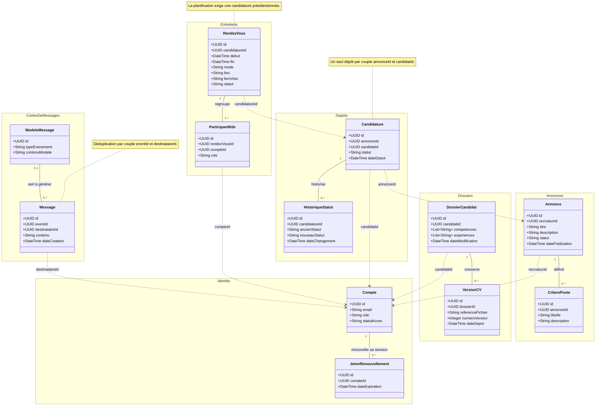
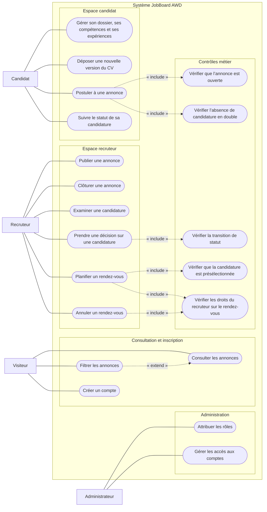

# Diagrammes UML — JobBoard AWD

## 1. Diagramme de classes par microservice

Les namespaces regroupent les classes par microservice. Les liens en pointillés représentent des références par identifiant entre services.

## 2. Diagramme de cas d’utilisation

